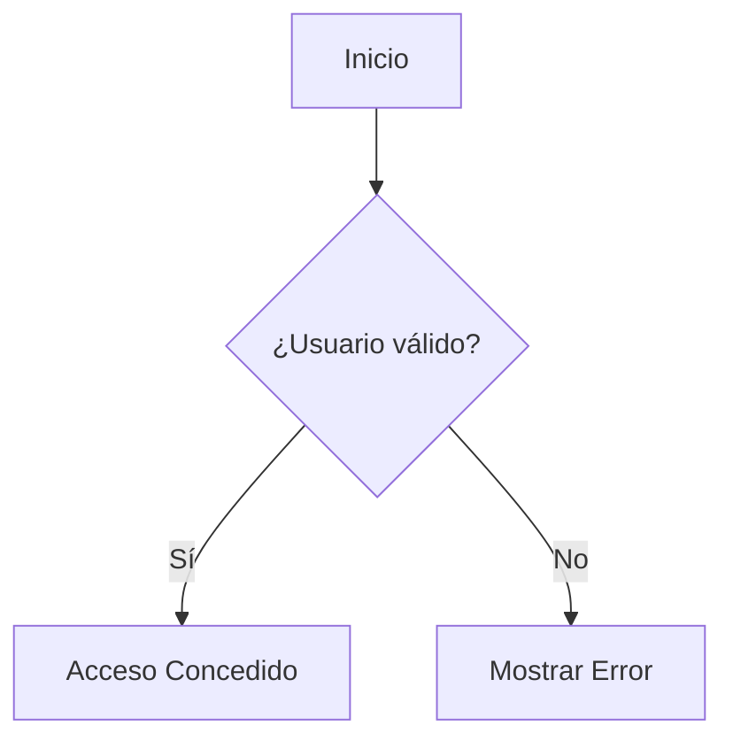

# Guía Rápida de Sintaxis Markdown

Documento de referencia para la maquetación y formato de notas de estudio en la bitácora.

---

## 1. Encabezados (Títulos)

Usa el símbolo `#` seguido de un espacio. A menor número de `#`, mayor jerarquía.

* `# Título Principal (H1)` - Usar solo uno por documento
* `## Sección (H2)`
* `### Subsección (H3)`
* `#### Tema específico (H4)`

---

## 2. Formato de Texto

* **Texto en negrita:** Usar dos asteriscos `**texto**` o dos guiones bajos `__texto__`.
* *Texto en cursiva:* Usar un asterisco `*texto*` o un guión bajo `_texto_`.
* ***Texto en negrita y cursiva:*** Usar tres asteriscos `***texto***`.
* ~~Texto tachado:~~ Usar dos virgulillas `~~texto~~`.

---

## 3. Listas

### Listas no ordenadas (Viñetas)
Usa asteriscos `*`, guiones `-` o signos de más `+`:

* Elemento principal 1
* Elemento principal 2
  * Subelemento alineado con sangría de 2 espacios
  * Otro subelemento

### Listas ordenadas (Numeradas)
Usa números seguidos de un punto:

1. Primer paso
2. Segundo paso
3. Tercer paso

---

## 4. Bloques de Código y Sintaxis

### Código en línea
Usa una comilla invertida simple al inicio y al final para resaltar variables o comandos dentro de un párrafo:
Aplica el comando `git status` o la variable `usuarioNombre`.

### Bloques de código con resaltado
Usa tres comillas invertidas indicando el lenguaje al inicio para activar el coloreado de sintaxis:

```csharp
// Ejemplo de código C#
public class Usuario 
{
    public string Nombre { get; set; }
    
    public void Saludar() 
    {
        Console.WriteLine($"Hola, {Nombre}");
    }
}
```

```javascript
// Ejemplo de código JavaScript
function saludar(nombre) {
    console.log(`Hola, ${nombre}`);
}
```

```bash
# Ejemplo de comandos en Terminal
git add .
git commit -m "Mensaje de commit"
git push origin main
```

---

## 5. Enlaces e Imágenes

* **Enlace web o interno:** `[Texto visible](URL_o_ruta)`
  * Ejemplo: `[Ir a GitHub](https://github.com)`
  * Ejemplo local: `[Ver herramientas](./m1_herramientas-microsoft-backend.md)`

* **Imagen:** ``
  * Ejemplo: ``

---

## 6. Tablas

Utiliza barras verticales `|` para las columnas y guiones `-` para definir el encabezado.

| Módulo | Tema Principal | Lenguaje |
| :--- | :---: | ---: |
| Módulo 1 | Fundamentos | Markdown / Git |
| Módulo 2 | Lógica y Backend | C# / .NET |
| Módulo 3 | Base de Datos | SQL |

> **Nota de alineación:** 
> * `:---` Alineación a la izquierda (por defecto).
> * `:---:` Alineación al centro.
> * `---:` Alineación a la derecha.

---

## 7. Citas y Notas Destacadas

Usa el carácter `>` al inicio de la línea para resaltar notas, advertencias o definiciones:

> **Importante:** Recuerda nunca subir contraseñas o claves secretas a un repositorio público en GitHub.

---

## 8. Línea Separadora

Usa tres guiones `---` o tres asteriscos `***` en una línea aislada para crear una división visual entre secciones:

---

## 9. Diagramas con Mermaid (Opcional)

Puedes crear diagramas de flujo escribiendo `mermaid` en el bloque de código:

