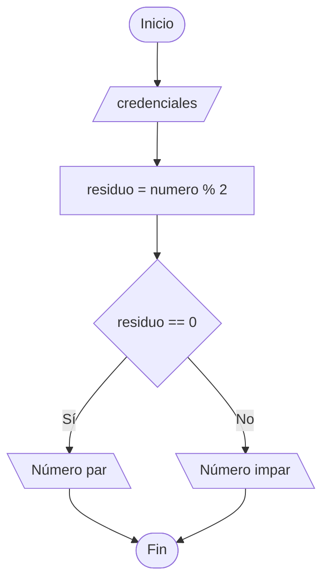

# Práctica: Inicio de sesión

## 1. Definición del problema
Crear un sistema de login donde los usuarios puedan introducir su nombre de usuario y contraseña. El sistema debe validar estas credenciales y permitir o denegar el acceso.

## 2. Identificar los procesos clave
* Introducir nombre de usuario y contraseña.
* Validación de credenciales.
* Conceder o denegar el acceso en función de la validación.

## 3. Diagrama de flujo y Pseudocódigo

<div class="comparativa-codigo">



```pseudocode
Inicio Inicio_Sesion
Fin Inicio_Sesion
```
</div>