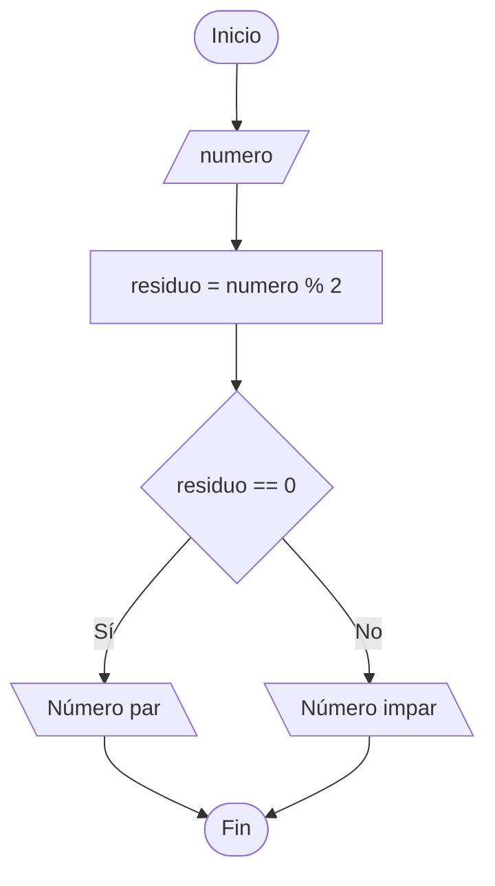

# Práctica: Número par o impar

## 1. Definición del problema
Programa que obtiene un número. Si es par imprimir mensaje "Número par"; de lo contrario, imprimir "Número impar".

## 2. Identificar los procesos clave
* Introducir número
* Validar si es par o impar
* Mostrar mensaje si es par o impar

## 3. Diagrama de flujo y Pseudocódigo

<div class="comparativa-codigo">



```pseudocode
Inicio Algoritmo_Par_Impar

    // Declaración de variables
    Entero: numero, residuo

    // Entrada de datos
    Leer(numero)

    // Proceso
    residuo <- numero % 2

    // Decisión / Estructura condicional
    Si residuo == 0 Entonces
        Escribir("Número par")
    Sino
        Escribir("Número impar")
    FinSi

Fin Algoritmo_Par_Impar
```
</div>